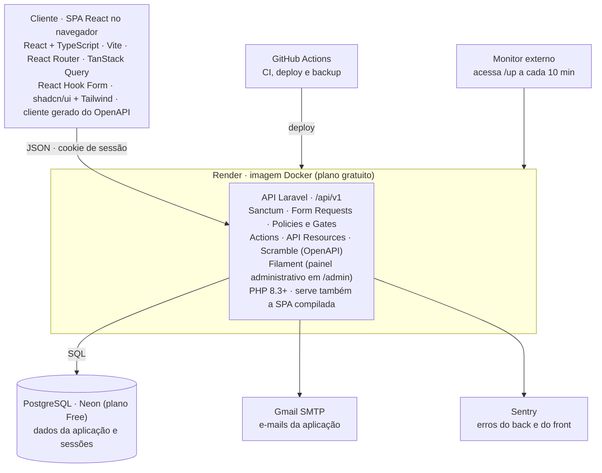

# ConectaCC — Stack e Decisões Técnicas

Última atualização: 13/10/2026

O ConectaCC é uma API REST em Laravel consumida por uma SPA em React, publicadas juntas numa imagem Docker no Render, com PostgreSQL no Neon e todos os serviços externos em planos gratuitos. Este documento registra apenas a stack e as decisões de tecnologia: o que foi escolhido e por quê. As regras de como cada parte funciona (autenticação, papéis, moderação, modelo de dados, convenções de código) ficam no documento de Implementação.

Complementa o `decisoes.md`, que registra as decisões de produto.

## Visão geral

A API é o contrato do sistema: a SPA de hoje e um eventual app móvel usam as mesmas rotas, e toda regra de negócio e de autorização fica no backend e no banco. A única tela renderizada no servidor é o painel administrativo.

## Stack por camada

Cada tecnologia abaixo está justificada na decisão indicada entre parênteses.

**Backend**

| Componente            | Escolha                                                        |
| --------------------- | -------------------------------------------------------------- |
| Linguagem e framework | PHP 8.4 e Laravel 13, usado como API (2) |
| Autenticação        | Laravel Sanctum (2)                                            |
| Validação           | Form Requests (2)                                              |
| Autorização         | Policies e Gates (2)                                           |
| Regras de negócio    | Actions, uma classe por caso de uso (2)                        |
| Respostas             | API Resources (2)                                              |
| Documentação da API | Scramble, OpenAPI gerado do código (1)                        |
| Painel administrativo | Filament (5)                                                   |
| E-mail                | Mailer do Laravel via SMTP (7)                                 |

**Frontend**

| Componente         | Escolha                                                        |
| ------------------ | -------------------------------------------------------------- |
| Biblioteca e build | React + TypeScript, Vite (3)                                   |
| Roteamento         | React Router                                                   |
| Dados do servidor  | TanStack Query (cache, loading, erro, "Mostrar mais", polling) |
| Cliente HTTP       | `openapi-typescript` + `openapi-fetch`, gerado do OpenAPI  |
| Formulários       | React Hook Form, com erros 422 mapeados para os campos         |
| Componentes        | shadcn/ui (Radix) + Tailwind                                   |

**Dados**

| Componente | Escolha                  |
| ---------- | ------------------------ |
| Banco      | PostgreSQL (4)           |
| Sessões   | No próprio Postgres (2) |

**Infraestrutura e operação**

| Componente                        | Escolha                                                 |
| --------------------------------- | ------------------------------------------------------- |
| Aplicação                       | Render, plano gratuito, imagem Docker (6)               |
| Banco de produção               | Neon, plano Free (6)                                    |
| Disponibilidade                   | Monitor externo em`/up` (6)                           |
| E-mail                            | SMTP do Gmail da conta do projeto (7)                   |
| Erros                             | Sentry, plano gratuito (8)                              |
| Repositório, CI, deploy e backup | GitHub e GitHub Actions (9, 10)                         |
| Desenvolvimento                   | Docker Compose (Sail) com PHP, PostgreSQL e Mailpit (9) |
| Runtime da imagem                 | `serversideup/php:8.4-fpm-nginx` (9)                    |
| Banco em dev, CI e produção       | PostgreSQL 17 (4)                                       |
| Node                              | 24 LTS, npm (3)                                         |
| Fontes                            | Plus Jakarta Sans + Inter, auto-hospedadas (`@fontsource-variable`) |

**Qualidade**

| Componente            | Escolha                                                 |
| --------------------- | ------------------------------------------------------- |
| Testes de API         | Pest (11)                                               |
| Análise estática    | Pint, Larastan (nível 6), ESLint (com`jsx-a11y`) e `tsc` (11) |
| Segredos              | gitleaks no CI + secret scanning do GitHub (9)          |
| Front e ponta a ponta | Vitest e Playwright (11)                                |

## Decisões: arquitetura e stack

As decisões seguem o formato do `decisoes.md`: o que foi decidido, por quê, o que foi descartado e o que muda por causa disso. Tomadas em outubro de 2026 por Marcelo Henrique Germiniani Panho, com Viviane Biazus Aneris nas que afetam o produto.

### 1. Arquitetura API-first

**Decisão.** O backend é uma API REST em JSON, versionada em `/api/v1` e documentada em OpenAPI gerado do código, consumida por uma SPA. A SPA compilada é servida pelo próprio backend, na mesma origem, num único deploy.

**Motivo.**

- permitir um cliente móvel no futuro sem reescrever o backend;
- evitar CORS e cookies entre sites;
- manter um único serviço gratuito em produção.

**Alternativas descartadas.**

- monólito com telas no servidor (Livewire): não produz API reutilizável;
- SPA e API em hosts separados: CORS, cookies entre sites e dois deploys;
- backend como serviço (Supabase): regras espalhadas em policies e funções SQL; projetos gratuitos pausam após 7 dias sem uso.

**Consequência.** A API é o contrato do sistema. Toda regra de negócio e de autorização fica no backend e no banco; o frontend nunca é fonte de verdade e pode ir para outro host no futuro sem mudar a API.

### 2. Backend

**Decisão.** Laravel (PHP 8.3+), usado como API, com Sanctum, Form Requests, Policies e Gates, Actions (uma classe por caso de uso), API Resources e Scramble. Controllers são finos: recebem o Form Request, chamam uma Action e devolvem um Resource.

**Motivo.**

- domínio do desenvolvedor responsável, reduzindo o risco ao prazo;
- autenticação, recuperação de senha, limite de tentativas, policies e e-mail já prontos.

**Alternativas descartadas.**

- Node.js + TypeScript (Hono, Drizzle, Better Auth): melhor alinhamento com o currículo e uma linguagem só; maior risco ao prazo de novembro;
- Django + DRF: autenticação pronta e painel nativo, mas exigiria aprender o framework durante o prazo;
- FastAPI: autenticação completa montada à mão;
- Spring Boot: mais infraestrutura para escrever.

**Consequência.** Os alunos do curso estudam Node.js e Python, não PHP; futuros mantenedores terão que aprender PHP e Laravel. Mitigação: seguir as convenções do framework, manter o OpenAPI publicado, usar os testes de API como documentação viva e manter um README de operação. Se a continuidade se mostrar difícil, a API versionada permite reescrever o backend sem mudar o frontend.

### 3. Frontend

**Decisão.** React + TypeScript com Vite, React Router, TanStack Query, React Hook Form, shadcn/ui + Tailwind e cliente HTTP gerado do OpenAPI (`openapi-typescript` + `openapi-fetch`).

**Motivo.**

- experiência atual do desenvolvedor;
- caminho para React Native no futuro;
- componentes acessíveis prontos (foco, teclado, modais, drawer).

**Alternativa descartada.** Vue 3: atende tecnicamente e tem curva menor, mas perde nos três motivos acima.

### 4. Banco de dados

**Decisão.** PostgreSQL.

**Motivo.** `unaccent` para busca sem acentos, índices parciais para a fila de Moderação e `CHECK` constraints para garantir regras no banco.

**Alternativa descartada.** MySQL: atenderia, com menos recursos para essas regras.

### 5. Painel administrativo

**Decisão.** Filament em `/admin`, acessível somente a ADMINISTRADOR. O painel serve para:

- gestão de usuários e papéis;
- consulta de moderações;
- atendimento de pedidos de exclusão de conta;
- cadastros curados (oportunidades do IFSul, canais da Comunidade, catálogo de disciplinas);
- consulta de dados para suporte.

O que cada função do painel pode fazer está definido no documento de Implementação.

**Motivo.** O Render gratuito não é um ambiente confiável para comandos manuais em produção; o painel substitui mecanismos improvisados e é gratuito, mantido e construído sobre os models existentes.

**Consequência.** É a única exceção à regra de nenhuma tela renderizada no servidor: o Filament usa Livewire e a sessão do Laravel. A versão do Filament precisa ser compatível com a do Laravel adotada.

## Decisões: infraestrutura e operação

### 6. Hospedagem

**Decisão.** Aplicação no Render (plano gratuito), como uma imagem Docker com API, SPA e painel; banco no Neon (plano Free). Hospedagem inicialmente fora do IFSul, sem orçamento e sem domínio próprio. A hibernação do Render é tratada com um monitor externo acessando `/up` a cada 10 minutos, se os termos do Render permitirem; caso contrário, com aviso no convite aos alunos.

| Serviço                     | Limite que importa                                                     |
| ---------------------------- | ---------------------------------------------------------------------- |
| Render, web service gratuito | Hiberna após 15 min sem tráfego; cerca de 1 min para acordar         |
| Neon, plano Free             | 1 GB e 100 horas de computação por mês; suspende após 5 min ocioso |

**Motivo.** Custo zero, sem cartão. O Postgres gratuito do próprio Render expira em 30 dias, por isso o banco fica no Neon.

**Alternativas descartadas.**

- Oracle Always Free: única VM gratuita sem hibernação, mas exige cartão, teve cota reduzida em 2026 e pode recuperar instâncias ociosas;
- Supabase como banco: pausa projetos após 7 dias sem uso.

**Consequência.** A defesa contra mudanças nos planos gratuitos é a portabilidade: imagem Docker, configuração só em variáveis de ambiente e Postgres padrão. Trocar de provedor, inclusive para hospedagem institucional, é trocar a connection string e refazer o deploy. Resolve a pendência 2.1. O Render gratuito não tem Shell: comandos administrativos (como mudar o papel de um usuário) rodam pelo workflow "Promover usuário" no GitHub Actions.

### 7. E-mail

**Decisão.** E-mails da aplicação (recuperação de senha, se implementada — decisoes.md 52.9) pelo SMTP do Gmail, com senha de app, na conta Google do projeto. Envio síncrono, sem fila. Mailpit no desenvolvimento.

**Motivo.** Sem domínio próprio, provedores transacionais não conseguem autenticar o remetente; o Gmail envia pelos servidores do Google.

**Consequência.** Com domínio próprio, a troca para um provedor com SPF/DKIM é só configuração.

### 8. Monitoramento de erros

**Decisão.** Sentry (plano gratuito), no backend e no frontend, desde a semana de fundação. Sem envio de e-mail, nome ou corpo das requisições; usuário identificado só pelo ID interno.

**Motivo.** Sem alerta, um erro só é descoberto quando um aluno reclama, e muitos desistem sem avisar.

### 9. Repositório, contas e deploy

**Decisão.**

- monorrepo (`backend/`, `frontend/`, `docs/`) numa organização no GitHub, com Marcelo e Viviane como proprietários;
- repositório público, com varredura de segredos; `.env` fora do Git; segredos só no Render e no GitHub Actions;
- `main` protegida, mudanças por pull request com CI verde, mensagens em Conventional Commits;
- uma conta Google do projeto é dona de Render, Neon, Gmail, Sentry e monitor, com credenciais num cofre compartilhado;
- deploy: Dockerfile multiestágio que compila o React para o `public/` do Laravel; migrations com `php artisan migrate --force` na inicialização do container.

**Motivo.** A passagem para futuros mantenedores não pode depender de contas pessoais; o repositório público vale como portfólio.

### 10. Backup

**Decisão.** `pg_dump` semanal por workflow agendado no GitHub Actions, criptografado e guardado no Google Drive da conta do projeto.

**Regra.** O dump nunca vai sem criptografia para o repositório ou para artefatos públicos, porque contém dados de estudantes.

### 11. Ferramentas de teste e qualidade

**Decisão.**

- **testes de API:** Pest, rodando contra PostgreSQL real no CI;
- **análise estática:** Pint, Larastan, ESLint (com `jsx-a11y`) e `tsc`;
- **frontend e ponta a ponta:** Vitest + Testing Library e Playwright, adotados depois da liberação;
- tudo roda no GitHub Actions a cada pull request.

**Motivo.** Pest e Larastan são o padrão do ecossistema Laravel; testar contra o mesmo banco de produção é necessário porque parte das regras vive no banco.

**Consequência.** Quais testes são obrigatórios antes da liberação está definido no documento de Implementação.

## Planos condicionados

Nada abaixo entra no MVP. Cada item tem um gatilho objetivo, e a maioria é troca de driver ou configuração no Laravel, sem reescrever código. O público do MVP são estudantes de CC de um câmpus, na casa das centenas; a "fila de Moderação" é uma fila de produto (consulta por status), não uma fila de mensagens.

| Item                            | Tecnologia prevista                          | Gatilho                                                     |
| ------------------------------- | -------------------------------------------- | ----------------------------------------------------------- |
| Fila de jobs                    | Driver`database` do Laravel; Redis depois  | Envio de e-mail lento ou e-mails também nas notificações |
| Notificações em tempo real    | Laravel Reverb (WebSocket)                   | Necessidade real de tempo real                              |
| Busca dedicada                  | Laravel Scout + Meilisearch                  | Milhares de registros ou relevância ruim do Postgres       |
| Cache e sessões fora do banco  | Redis                                        | Consultas lentas medidas ou mais de uma instância          |
| Upload de arquivos              | Armazenamento S3-compatível                 | Upload entrar no escopo                                     |
| Frontend em host separado       | CDN ou host estático com CORS               | Domínio próprio ou tráfego que justifique                |
| Hospedagem sem hibernação     | Institucional ou plano pago                  | Monitor não permitido ou piloto maior                      |
| Domínio próprio               | GitHub Student Pack (1 ano) ou institucional | Antes de um piloto maior ou da divulgação ao curso        |
| E-mail transacional             | Provedor com SPF/DKIM                        | Domínio próprio ou Gmail indo para spam                   |
| Testes de front e ponta a ponta | Vitest; Playwright                           | Após a liberação, antes de um piloto maior               |

**Caminho para o celular**, do mais barato ao mais caro; cada passo só se o anterior não bastar, e em nenhum deles o backend muda:

1. **PWA:** manifest e service worker na SPA atual; instalável, sem lojas.
2. **Capacitor:** a mesma SPA empacotada para as lojas; exige pagar as contas de desenvolvedor.
3. **React Native (Expo):** app nativo consumindo `/api/v1` com token Sanctum; só com demanda demonstrada.

## Pontos provisórios

Decisões de tecnologia em vigor, mas que podem mudar. As regras provisórias de funcionamento ficam no documento de Implementação.

- **Monitor contra hibernação (6):** depende de os termos do Render permitirem; caso contrário, os alunos são avisados de que o primeiro acesso pode demorar.
- **Hospedagem fora do IFSul (6):** inicial; pode migrar para hospedagem institucional sem mudança de código.
- **SMTP do Gmail (7):** até haver domínio próprio.
